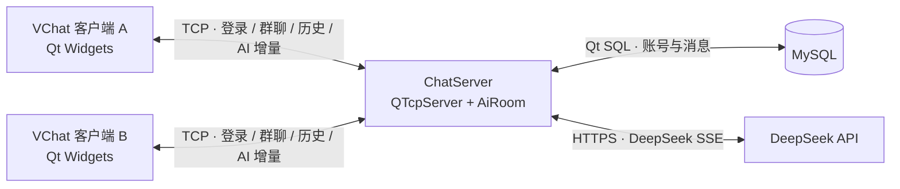

# VChat

**基于 C++ / Qt 的多人实时聊天与 AI 协作平台**

VChat 从 Qt 多人聊天室起步，采用独立客户端与服务器架构。当前版本支持实时群聊、按房间切换消息与成员、以及 Vivi AI 助手：同一房间的成员可以共同看到流式回答。项目正向多人 AI 协作平台演进；房间创建/加入界面、个人与团队 AI 模式仍在规划中。

[开发路线图](ROADMAP.md) · [GitHub 仓库](https://github.com/OscarHsuaa/VChat)

## 项目简介

客户端使用 Qt Widgets 构建桌面界面，通过 `QTcpSocket` 连接独立的 `ChatServer`。服务器使用 `QTcpServer` 维护成员连接，通过 MySQL 保存聊天历史，并使用 `QNetworkAccessManager` 异步调用 DeepSeek API。服务端支持房间、成员、邀请与消息隔离；客户端提供房间导航、创建、切换、历史恢复与定向成员邀请。公开房间发现界面仍待开发。Vivi 是 AI 助手，不计入真人在线人数。

## 核心功能

| 功能 | 当前实现 |
| --- | --- |
| 账号登录 | 客户端验证账号、密码和验证码；服务器校验已有 MySQL 账号并发放会话标识。当前未提供自助注册流程。 |
| 多人群聊 | TCP 传输文本消息，广播给在线成员；显示在线列表、加入/离开提示和连接状态。 |
| 智能提及 | 输入 `@` 可搜索在线成员和 Vivi；提及普通成员仍是群聊消息，`@Vivi` 可触发 AI 请求。 |
| Vivi 流式回答 | 服务器解析 DeepSeek SSE 增量并转发；客户端在同一气泡中逐字显示，完成后渲染 Markdown。 |
| AI 消息操作 | 复制全文、复制代码、重新生成、点赞/点踩本地反馈；重新生成沿用原 AI 消息 ID。 |
| 多人并发 | 请求具有独立的请求 ID、消息 ID 和生成轮次；服务端限制并发数，并对超限、取消和超时给出反馈。 |
| 历史恢复 | 普通消息与 Vivi 回复保存在 MySQL；登录后统一回放，按稳定序号及原提问关联排序。 |
| 多任务聊天室基础 | 服务端可创建邀请制/公开房间，管理成员、一次性令牌与定向邀请，并隔离消息、历史与 Vivi 流；客户端可创建房间、查看已加入房间、切换消息和成员、发送及处理定向邀请。公开房间发现界面尚未实现。 |

Markdown 回复支持标题、列表、强调、行内代码和代码块；C++、Python、SQL、JSON 等代码块提供基础高亮与复制。模型输出按不执行原始 HTML 的方式渲染。重新生成、历史恢复和多人并发的桌面端最终验收状态见 [ROADMAP.md](ROADMAP.md)。

## 技术栈

| 技术 | 用途 |
| --- | --- |
| C++、Qt Widgets、Qt Svg | 客户端界面、自定义消息组件与 SVG 图标。 |
| `QTcpSocket`、`QTcpServer` | 客户端与服务器之间的长连接及多人消息广播。 |
| Qt SQL、MySQL、`QMYSQL` 驱动 | 账号校验与聊天历史持久化。 |
| `QNetworkAccessManager`、Qt Network / TLS | 服务端异步 HTTPS 请求与 DeepSeek SSE 增量接收。 |
| CMake 3.19+、Qt 6.5+ | 分别构建客户端、服务器和测试程序；当前开发环境使用 Qt 6.10.2、Qt Creator、Windows MinGW 64-bit。 |

## 系统架构



客户端不会直接持有 DeepSeek API Key。服务器为每次 AI 请求分配独立标识，在回复气泡首次出现时写入稳定的历史位置，后续增量更新同一条消息；历史恢复和实时展示共用消息关联信息。

## 项目结构

```text
VChat/
├─ ChatDemo_1/                 # Qt Widgets 客户端
│  ├─ CMakeLists.txt
│  ├─ logindialog.{h,cpp,ui}   # 登录与验证码
│  ├─ mainwindow.{h,cpp,ui}    # 聊天界面、消息与在线成员
│  ├─ aimarkdownwidget.{h,cpp} # Vivi Markdown 与代码块
│  ├─ mentioninput.{h,cpp}    # @成员输入
│  ├─ roomsidebarwidget.{h,cpp} # 房间导航与折叠
│  ├─ login_icons.qrc
│  └─ icons/                   # SVG 资源
├─ ChatServer/                 # TCP 服务器与 AI 服务
│  ├─ CMakeLists.txt
│  ├─ main.cpp
│  ├─ airoom.{h,cpp}
│  ├─ aiservice.{h,cpp}
│  ├─ roomstore.{h,cpp}         # 房间、成员与邀请存储
│  ├─ ROOM_PROTOCOL.md          # 房间 TCP 协议
│  └─ migrations/              # 历史与房间表迁移脚本
├─ tests/                      # SSE、并发、客户端渲染等测试
├─ docs/images/                # 项目截图存放位置
├─ ROADMAP.md
└─ README.md
```

## 界面截图

仓库目前没有可用于 README 的正式截图。添加截图后，可将图片放入 `docs/images/`，再将下表替换为相对路径图片链接：

| 建议截图 | 展示重点 |
| --- | --- |
| 登录页面 | 登录表单、验证码和服务器设置；当前无自助注册页。 |
| 聊天主界面 | 双栏布局、在线成员与消息气泡。 |
| Vivi 流式回答 | 同一气泡中的生成过程。 |
| 多人同时使用 Vivi | 两个客户端、独立请求与共享回复。 |
| Markdown 与代码块 | 高亮、复制代码和 AI 消息操作。 |

## 环境要求与运行

### 1. 准备工具

- Windows、Qt Creator、与 Qt 套件匹配的 64 位 C++ 编译器；项目当前使用 Qt **6.10.2 + MinGW 64-bit**。
- CMake **3.19+**。客户端需要 Qt `Core`、`Widgets`、`Network`、`Svg`；服务器需要 `Core`、`Network`、`Sql`。
- MySQL，以及与当前 Qt/编译器匹配的 `QMYSQL` 插件；DeepSeek HTTPS 请求还需要可用的 Qt TLS 后端。

### 2. 准备数据库

服务器当前连接本机 MySQL 的 `vchat_demo` 数据库。仓库提供 [历史表迁移 001](ChatServer/migrations/001_chat_history.sql)、[AI 状态迁移 002](ChatServer/migrations/002_ai_history_state.sql)、[房间迁移 003](ChatServer/migrations/003_rooms.sql)、[定向邀请迁移 004](ChatServer/migrations/004_direct_room_invites.sql) 和 [聊天室管理迁移 005](ChatServer/migrations/005_room_management.sql)，**没有提供包含 `users`、旧 `messages` 表的完整新库初始化脚本**。因此，新环境需先准备与当前服务器查询兼容的原有账号/消息库，不能仅运行迁移脚本就完成首次建库。`001` 会从已有 `messages` 表回填普通消息；`002` 增加 AI 状态列；`003` 创建房间、成员、令牌邀请表及默认大厅；`004` 新增指定接收者的邀请表；`005` 仅添加房间软解散时间字段。请先备份数据库，再按顺序执行适用的迁移；房间协议和回滚说明见 [ROOM_PROTOCOL.md](ChatServer/ROOM_PROTOCOL.md)。

对于已经具备原有表的数据库，可在项目根目录的 **cmd.exe** 中按缺失迁移顺序执行（MySQL 会交互提示输入密码）。已完成 001～004 的正式库备份后只需运行 005：

```bat
mysql --default-character-set=utf8mb4 -u root -p vchat_demo < ChatServer\migrations\001_chat_history.sql
mysql --default-character-set=utf8mb4 -u root -p vchat_demo < ChatServer\migrations\002_ai_history_state.sql
mysql --default-character-set=utf8mb4 -u root -p vchat_demo < ChatServer\migrations\003_rooms.sql
mysql --default-character-set=utf8mb4 -u root -p vchat_demo < ChatServer\migrations\004_direct_room_invites.sql
mysql --default-character-set=utf8mb4 -u root -p vchat_demo < ChatServer\migrations\005_room_management.sql
```

服务器的数据库连接参数目前写在 `ChatServer/main.cpp` 中；部署到其他环境前需核对本地数据库配置。**请勿把真实数据库密码提交到公开仓库。** 当前账号校验也依赖既有数据库中的账号记录，自助注册尚未实现。

### 3. 配置 AI 服务

在启动 `ChatServer` 的进程环境中设置 `DEEPSEEK_API_KEY`。例如，仅在当前 PowerShell 会话中设置：

```powershell
$env:DEEPSEEK_API_KEY = "<your-deepseek-api-key>"
```

请将占位符替换为自己的密钥，勿写入源码或提交到 Git。若从 Qt Creator 启动服务器，应确认其运行环境能读取该变量；服务器启动日志只报告是否已配置及 TLS 是否可用，不显示密钥。缺少 Key 时，普通聊天仍可使用，Vivi 无法调用模型。

### 4. 构建与启动

推荐在 Qt Creator 中分别打开 `ChatServer/CMakeLists.txt` 与 `ChatDemo_1/CMakeLists.txt`，为两者选择同一套 Qt 6.10.2 MinGW 64-bit Kit，先构建并运行服务器，再启动客户端。

也可以在已配置 Qt 与 MinGW 环境的终端中分别构建：

```powershell
cmake -S ChatServer -B ChatServer/build/local -G Ninja -DCMAKE_PREFIX_PATH="C:/Qt/6.10.2/mingw_64"
cmake --build ChatServer/build/local

cmake -S ChatDemo_1 -B ChatDemo_1/build/local -G Ninja -DCMAKE_PREFIX_PATH="C:/Qt/6.10.2/mingw_64"
cmake --build ChatDemo_1/build/local
```

先在一个终端启动服务器：

```powershell
./ChatServer/build/local/ChatServer.exe
```

再在另一个终端启动客户端：

```powershell
./ChatDemo_1/build/local/ChatDemo_1.exe
```

服务器默认监听 **8080**；本机客户端登录页可使用 `127.0.0.1:8080`，局域网客户端使用服务器的实际 IPv4 地址。登录需要数据库中已有的有效账号。

### 常见问题

| 现象 | 检查方向 |
| --- | --- |
| 服务器提示缺少 `QMYSQL` | 检查 Qt SQL MySQL 插件及其与 Qt、MinGW、MySQL 客户端库的兼容性。 |
| 数据库连接失败或缺少 `chat_history.ai_state` | 检查 MySQL 服务、服务器数据库参数和迁移执行情况；不要删除旧数据。 |
| Vivi 显示暂时不可用 | 检查服务器进程是否读到 `DEEPSEEK_API_KEY`、Qt TLS 是否可用及 HTTPS 连接。 |
| 服务器无法监听 8080 | 检查是否已有另一个 `ChatServer.exe` 占用端口；确认运行的是最新构建。 |
| 客户端无法登录 | 检查服务器地址、MySQL 连接和数据库中是否有该账号。 |

## 技术实现要点

- **事件驱动 C/S 通信**：Qt 信号槽处理 TCP 连接、消息转发、在线成员更新和断线事件；协议按换行分帧，避免把一次 `readyRead` 误认为一条完整消息。
- **真实 AI 流式传输**：服务端异步接收 DeepSeek SSE 分片并解析增量，按请求 ID 和消息 ID 广播；客户端持续更新同一 Vivi 气泡，完成后渲染 Markdown。
- **并发与生命周期**：`AiRoom` 为请求维护独立状态、上下文、计时器和生成轮次；当前最多同时处理 3 个 AI 请求，并有上限为 12 的等待队列。
- **历史关联与排序**：普通消息和 AI 回复写入同一历史表。Vivi 气泡创建时固定消息 ID 与序号，完成、失败和重新生成只更新原记录；旧数据按原提问关联兼容回放。
- **安全渲染**：AI 文本按 Markdown 展示，代码块使用独立控件与基础语法高亮，原始 HTML 不作为可执行页面内容加载。

## 开发状态与路线

| 状态 | 范围 |
| --- | --- |
| 已实现 | 群聊、按房间导航与历史切换、房间成员状态、`@Vivi`、DeepSeek SSE、逐字显示、Markdown/代码块、消息持久化与回放，以及多任务聊天室的服务端基础；仍需实际桌面双窗口最终验收。 |
| 继续完善 | 重新生成与并发请求的桌面验收、历史分页、房间邀请的真实双客户端验收、公开房间发现界面、异常请求与断线重连等稳定性细节。 |
| 未来规划 | 公开房间发现与申请审核、个人/团队 AI 模式、持久化上下文、AI 辅助任务管理、文件共享、代码协作和多专业智能体。 |

当前没有发布版本号。Git 历史可见的主要开发阶段包括：**2026-11-06** 导入项目源码，**2026-11-07** 完善 Vivi 流式输出与历史恢复，**2026-11-08** 完善多人并发与历史排序。详细状态、验收边界和后续计划见 [ROADMAP.md](ROADMAP.md)。

## 聊天室权限与隐私（待部署验收）

房主可设置公开或私密房间，并分别授权普通成员邀请、编辑房间信息或移除其他普通成员。权限由服务器按已认证账号和数据库配置校验，不能由客户端标志绕过。新列由 [006_room_permissions.sql](ChatServer/migrations/006_room_permissions.sql) 添加；先备份数据库，按 [房间协议与迁移说明](ChatServer/ROOM_PROTOCOL.md) 执行。房主审核加入、公开房间发现页面与普通成员管理权限的转授尚未开放。该功能仍需正式数据库迁移及多客户端验收。

已有 005 结构的 Windows 环境，在备份完成后，可在仓库根目录的 **cmd.exe** 中执行（交互式输入数据库密码，不写入命令行）：

```bat
"C:\Program Files\MySQL\MySQL Server 8.4\bin\mysql.exe" -h 127.0.0.1 -P 3306 --protocol=TCP -u root -p vchat_demo < ChatServer\migrations\006_room_permissions.sql
```

执行前核对本机 MySQL 安装路径、端口及数据库名；迁移脚本可重复执行，不应在未备份的正式库上直接尝试。

## 作者

GitHub：[@OscarHsuaa](https://github.com/OscarHsuaa) · 仓库：[OscarHsuaa/VChat](https://github.com/OscarHsuaa/VChat)
