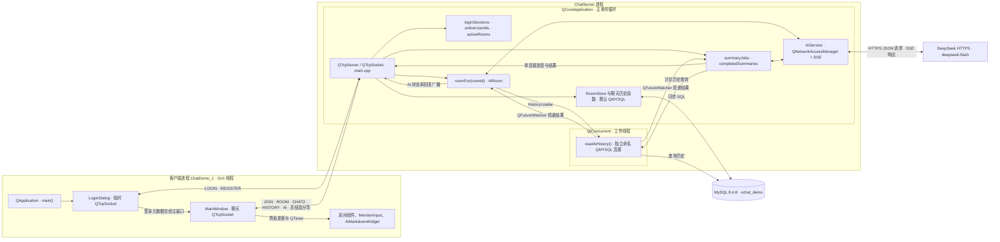
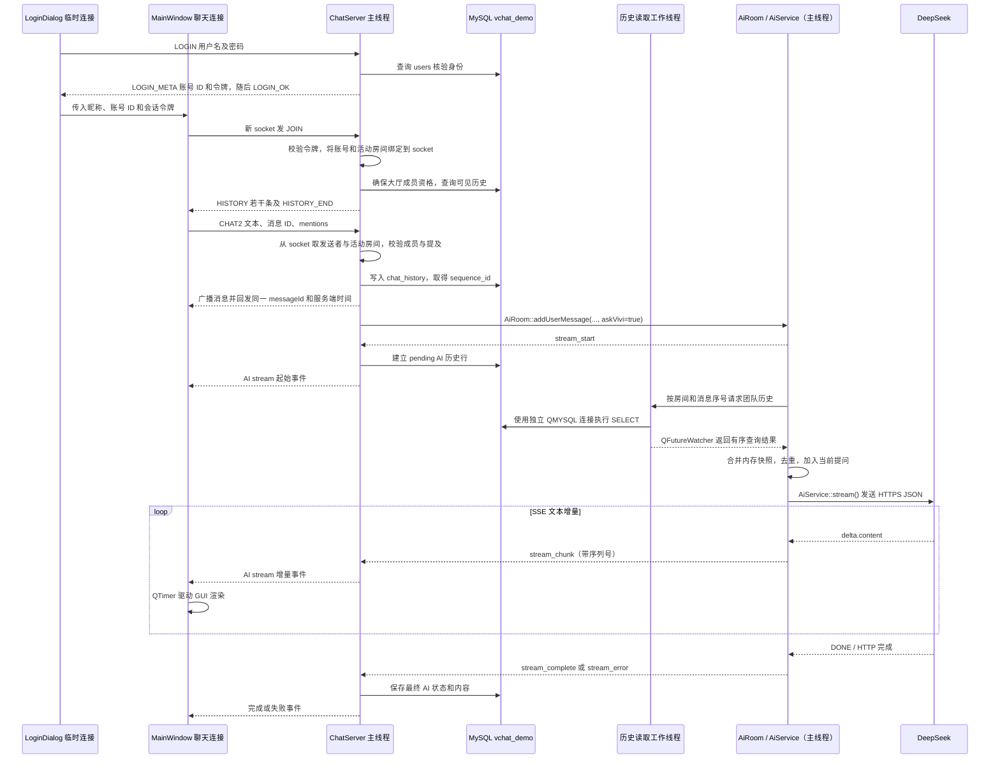

# VChat V0.5.1 · TASK-000 实际架构图

源码基线 `main` / `11bd5d5`。图中组件、协议和线程均来自当前仓库，数据库名称为本机实查结果。

## 1. 进程、线程与调用关系

图的入口：[客户端 `main()`](../ChatDemo_1/main.cpp#L7) · [服务端 `main()`](../ChatServer/main.cpp#L524) · [TCP 连接及帧分发](../ChatServer/main.cpp#L689) · [Vivi 工作线程](../ChatServer/main.cpp#L625) · [总结工作线程](../ChatServer/main.cpp#L1313) · [客户端网络及界面槽](../ChatDemo_1/mainwindow.cpp#L1798)。

## 2. 登录后触发一次现有 Vivi 回复

这是正常流程图。历史查询失败、超时和取消走现有错误分支。聊天及 Vivi 普通回复广播面向活动房间；总结生成是请求连接私有的，主动分享后才写历史并广播给该房间。见 [CHAT2](../ChatServer/main.cpp#L1424) · [广播与状态入库](../ChatServer/main.cpp#L570) · [上下文和队列](../ChatServer/airoom.cpp#L82) · [总结分享](../ChatServer/main.cpp#L1166)。
